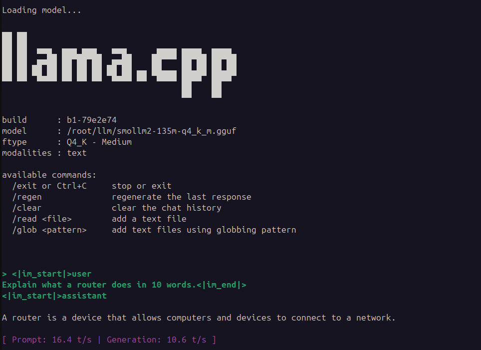
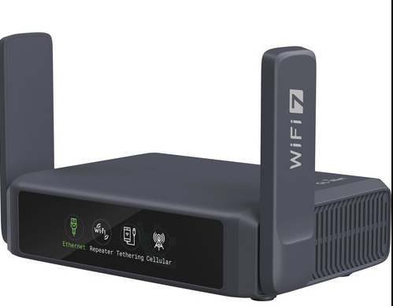

# llama-cpp-openwrt

Statically linked `llama.cpp` (`llama-cli`) builds and deployment scripts optimized for resource-constrained OpenWrt `aarch64` devices (musl libc), verified on hardware like the GL.iNet Slate 7 (GL-BE3600, Qualcomm IPQ5332).

<p align="center">
  
   
</p>

## Benchmark Performance

Tested on **GL.iNet Slate 7 (GL-BE3600)** running **OpenWrt 23.05** (Qualcomm IPQ5332, Quad-core ARM Cortex-A53 @ 1.5 GHz, ~900 MB RAM):

| Metric | Measurement |
|---|---|
| **Model** | SmolLM2-135M-Instruct (Q4_K_M GGUF, ~100 MB)[cite: 1] |
| **Prompt Processing** | **16.4 tokens/sec**[cite: 1] |
| **Token Generation** | **10.6 tokens/sec**[cite: 1] |
| **Idle System Memory** | 320 MB used / 515 MB available |
| **Active Memory (Loaded)** | 349 MB used / 486 MB available |
| **Net LLM Memory Footprint** | **~30 MB** (KV cache `-c 256` + runtime buffers) |
| **Active Threads** | 3 cores (reserves 1 core for `netifd` and `dnsmasq`) |

---

## Features

- **Static musl build:** Zero shared library dependencies (`libc`, `libstdc++`, etc.).
- **No OpenMP dependency:** Built with `-DGGML_OPENMP=OFF` to avoid dynamic `libgomp.so` linkage while using native POSIX threads.
- **ARMv8.0-A baseline:** Compiled with `-march=armv8-a -mtune=cortex-a53` without native instruction extensions to prevent `Illegal instruction` crashes on Cortex-A53.
- **Embedded-tuned:** Runs sub-150M parameter models within a ~250 MB total RAM envelope.

---

## Hardware Requirements

- **Architecture:** `aarch64` (ARM64)
- **RAM:** Minimum 512 MB free RAM
- **Storage:** ~150 MB free on `/overlay` or external USB mount

---

## Quick Start on OpenWrt

Pre-built binaries are available in the [v0.1.0 Release](https://github.com/assix/llama-cpp-openwrt/releases/tag/v0.1.0).

SSH into your router:

```sh
mkdir -p /root/llm && cd /root/llm

# 1. Download static binary from v0.1.0 release
wget -O llama-cli [https://github.com/assix/llama-cpp-openwrt/releases/download/v0.1.0/llama-cli](https://github.com/assix/llama-cpp-openwrt/releases/download/v0.1.0/llama-cli)
chmod +x llama-cli

# 2. Download SmolLM2-135M Instruct (Q4_K_M ~100 MB)
curl -L -o smollm2-135m-q4_k_m.gguf \
  "[https://huggingface.co/bartowski/SmolLM2-135M-Instruct-GGUF/resolve/main/SmolLM2-135M-Instruct-Q4_K_M.gguf](https://huggingface.co/bartowski/SmolLM2-135M-Instruct-GGUF/resolve/main/SmolLM2-135M-Instruct-Q4_K_M.gguf)"

# 3. Run test inference
./llama-cli \
  -m smollm2-135m-q4_k_m.gguf \
  -p "<|im_start|>user\nExplain what a router does in 10 words.<|im_end|>\n<|im_start|>assistant\n" \
  -n 32 \
  -c 256 \
  -t 3
```

---

## Router Execution Flags

| Flag | Value | Purpose |
|---|---|---|
| `-t` | `3` | Reserves 1 CPU core for critical networking processes (`netifd`, `dnsmasq`). |
| `-c` | `256` | Caps KV cache allocation to under ~20 MB RAM. |
| `-n` | `32` | Limits generation length to preserve CPU cycles. |

---

## Compiling from Source

To compile the static binary natively on an `aarch64` host:

```bash
docker run --rm -v "$(pwd):/dist" alpine:latest sh -c "
  apk add --no-cache git build-base cmake linux-headers && \
  git clone --depth 1 [https://github.com/ggerganov/llama.cpp.git](https://github.com/ggerganov/llama.cpp.git) && \
  cd llama.cpp && \
  cmake -B build \
    -DBUILD_SHARED_LIBS=OFF \
    -DGGML_OPENMP=OFF \
    -DGGML_NATIVE=OFF \
    -DCMAKE_C_FLAGS='-march=armv8-a -mtune=cortex-a53' \
    -DCMAKE_CXX_FLAGS='-march=armv8-a -mtune=cortex-a53' \
    -DCMAKE_EXE_LINKER_FLAGS='-static' && \
  cmake --build build --config Release -j\$(nproc) --target llama-cli && \
  strip build/bin/llama-cli && \
  cp build/bin/llama-cli /dist/
"
```

---

## Releases & Downloads

* **Latest Release:** [v0.1.0](https://github.com/assix/llama-cpp-openwrt/releases/tag/v0.1.0)

---

## License

MIT License. See [LICENSE](LICENSE) for details.
